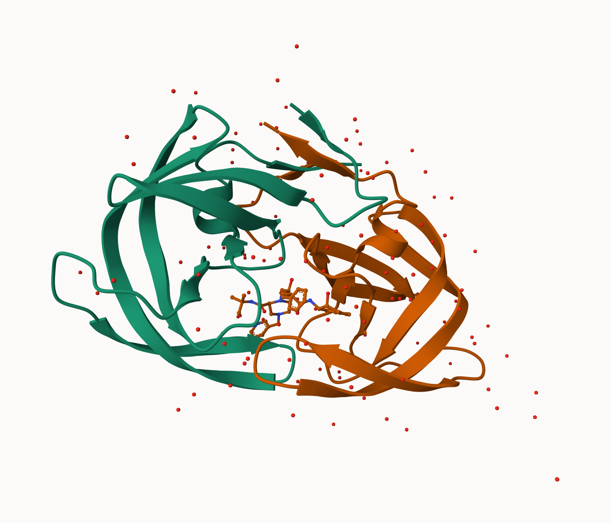
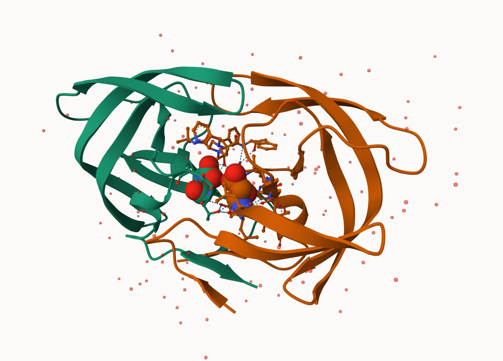
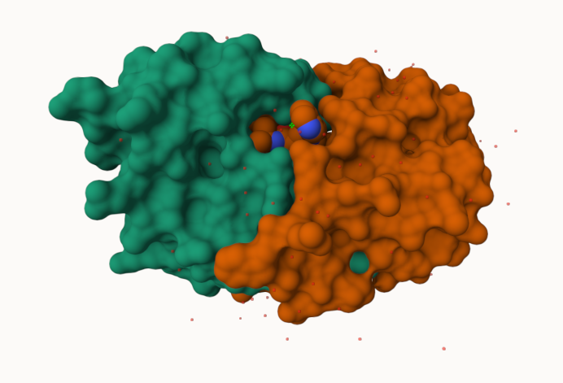
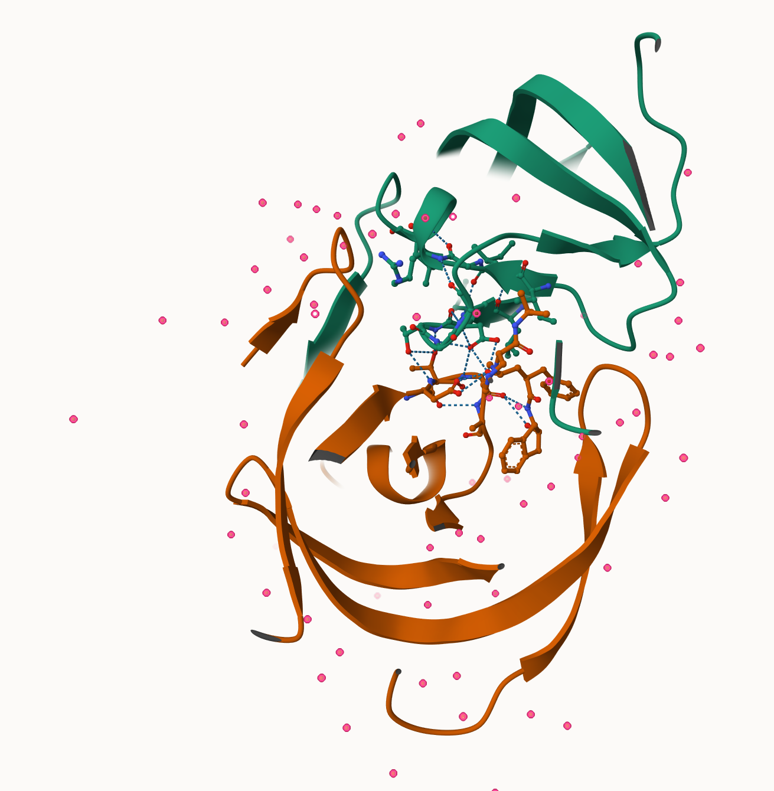

## Background

The [PDB database](https://www.rcsb.org) is the main repoistory of biomolecular strucutre information. Let's have a look a the composition of this dataset.

Visit PDB and click: Analyze -> PDb statistics -> Expiermental Methods -> Summary

We can "scrape" data from this page with the **datapasta** package that we can install frim CRAN `install.packages("datapasta")`.

Then "Addins -> Paste as data.frame":
```{r}
library(webshot)
```

```{r}
pdb <- data.frame(
  stringsAsFactors = FALSE,
       check.names = FALSE,
           Molecular.Type = c("Protein (only)",
                              "Protein/Oligosaccharide","Protein/NA",
                              "Nucleic acid (only)","Other","Oligosaccharide (only)",
                              "Total"),
         `Xray.▼` = c(184731, 10716, 9341, 3216, 178, 11, 208193),
                EM = c(25754, 4037, 7520, 347, 27, 1, 37686),
               NMR = c(12904, 34, 288, 1599, 35, 6, 14866),
       Integrative = c(365L, 8L, 27L, 3L, 4L, 0L, 407L),
  Multiple.methods = c(232L, 11L, 8L, 15L, 0L, 1L, 267L),
           Neutron = c(86L, 1L, 0L, 3L, 0L, 0L, 90L),
             Other = c(32L, 0L, 0L, 1L, 0L, 4L, 37L),
             Total = c(224104, 14807, 17184, 5184, 244, 23, 261546)
       )
```

```{r, echo=FALSE}
pdb
```

> Q1: What percentage of structures in the PDB are solved by X-Ray and Electron Microscopy.

```{r}

pdb[7,2:3] / pdb[7,9] * 100

```

> Q2: What proportion of structures in the PDB are protein?

```{r}
prot.ind <- pdb$Molecular.Type == "Protein (only)"

total.ind <- pdb$Molecular.Type == "Total"

round(pdb$Total[prot.ind] / pdb$Total[total.ind] * 100)
```

> Q3:Skipped!

```{r}

```

## The Mole-star viewer

This viewer is embedded into many newer bioinformatics datasets including the PDB and UniProt. The viewer is also accessible from it's homepage: https://molstar.org









> Q4: Water molecules normally have 3 atoms. Why do we see just one atom per water molecule in this structure?

-The structure of water contains one oxygen and 2 hydrogen atoms, but because the hydrogen atoms are much smaller than the oxygen they aren't picked up or detected by the X-ray crystllogrpahy. So the only aotm we see is actually the oxygen.

> Q5: There is a critical “conserved” water molecule in the binding site. Can you identify this water molecule? What residue number does this water molecule have

Yes, our structure has a conserved water molecule. The residue number for this water molecule is HOH 308.

> Q6: Generate and save a figure clearly showing the two distinct chains of HIV-protease along with the ligand. You might also consider showing the catalytic residues ASP 25 in each chain and the critical water (we recommend “Ball & Stick” for these side-chains). Add this figure to your Quarto document.



> Q7: optional

> Q8: Name one of the two non-protein residues?

A non protien residue is the MK1 which is bound to the HIV protease.


> Q9: How many protein chains are in this structure?

In this structure we have 2 chains, chain A and Chain B.

##  Bio3D in R

The **bio3d** packages for structural bioinformatics and allows us to read structural data and perform bioinformatics analysis all within R itself:

```{r}
library(bio3d)

hiv <- read.pdb("1hsg")
```


```{r}
hiv
```
```{r}
head( hiv$atom )
```

```{r}
pdbseq( hiv )
```

## Quick structure viz in R

WE can use the new **bio

```{r}
library(bio3dview)
```

```{r}
view.pdb(hiv)
```

```{r}
#select our two ASP 25 amino acids
asp <- atom.select(hiv, resno=25)

# Draw them highlighted in Spacefill
view.pdb(hiv,
         highlight = asp, 
         highlight.style = "spacefill")

```

## Predict the dynamics of ADK 
Let's read a new pdb strucurtre
```{r}

adk <- read.pdb("6s36")
m <- nma(adk)
         
plot(m)
```
Also make a little molecular moview (trajectory) for viewing in Mol-star

```{r}
mktrj(m, file= "adk_dynamics.pdb")
```


```{r}
view.nma(m)
```


